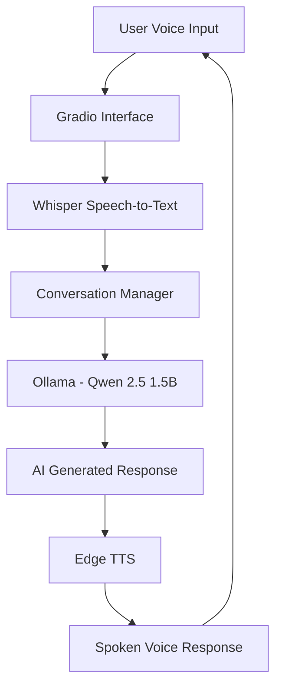

@'
# VoxMate AI 🎙️

**A Local AI-Powered Voice Assistant built with Python, Whisper, Ollama and Gradio.**

VoxMate AI is a personal voice assistant that listens to voice commands, converts speech into text, generates intelligent responses using a locally running LLM, and speaks back to the user.

## ✨ Features

- 🎙️ Voice input through a Gradio interface
- 📝 Speech-to-text using OpenAI Whisper
- 🧠 AI-powered responses using Ollama and Qwen 2.5
- 💬 Conversation history and contextual responses
- 🔊 Text-to-speech using Edge TTS
- 🖥️ Interactive Gradio web interface
- 🔒 Local AI inference without per-request API charges

## 🏗️ Project Architecture



## 🔄 Workflow

1. User records a voice command through the web interface.
2. Whisper processes the audio and converts speech into text.
3. Conversation Manager maintains the current session history.
4. Ollama runs the Qwen 2.5 1.5B model to generate a response.
5. Edge TTS converts the response into speech.
6. VoxMate returns the generated voice response to the user.

## 🛠️ Tech Stack

| Technology | Purpose |
|---|---|
| Python | Core programming language |
| OpenAI Whisper | Speech recognition |
| PyTorch | Deep learning framework |
| Ollama | Local LLM runtime |
| Qwen 2.5 1.5B | AI language model |
| Edge TTS | Text-to-speech |
| Gradio | Web interface |
| FFmpeg | Audio processing |

## 📁 Project Structure

```text
VoxMate-AI/
│
├── app.py
├── requirements.txt
├── README.md
├── .gitignore
│
├── src/
│   ├── __init__.py
│   ├── ai_brain.py
│   ├── conversation.py
│   ├── speech_to_text.py
│   └── text_to_speech.py
│
├── assets/
├── models/
├── outputs/
│
└── test_audio.mp3
```

## ⚙️ Installation & Setup

### 1. Clone the repository

```bash
git clone https://github.com/21vicky/VoxMate-AI.git
cd VoxMate-AI
```

### 2. Create a virtual environment

```bash
python -m venv venv
```

Activate it on Windows:

```powershell
.\venv\Scripts\Activate.ps1
```

### 3. Install dependencies

```bash
pip install -r requirements.txt
```

### 4. Install and start Ollama

Download Ollama from:

https://ollama.com/

Pull the required model:

```bash
ollama pull qwen2.5:1.5b
```

Make sure the Ollama service is running.

### 5. Install FFmpeg

Whisper requires FFmpeg for audio processing.

Download:

https://ffmpeg.org/

Make sure FFmpeg is available in your system PATH.

### 6. Run VoxMate AI

```bash
python app.py
```

Open the local Gradio interface:

http://127.0.0.1:7860

## 💻 Requirements

- Python
- Ollama
- FFmpeg
- Internet connection for Edge TTS
- Microphone
- Sufficient RAM to run the local language model

## 📌 Current Project Status

- [x] Project structure and environment setup
- [x] Whisper speech-to-text integration
- [x] Conversation manager
- [x] Ollama AI brain integration
- [x] Qwen 2.5 1.5B local model
- [x] Edge TTS integration
- [x] Gradio voice assistant interface
- [x] Voice assistant testing

## 🚀 Future Improvements

- [ ] More natural real-time voice conversations
- [ ] Wake-word activation
- [ ] Improved multilingual voice responses
- [ ] Persistent conversation memory
- [ ] Additional desktop assistant capabilities

## 👨‍💻 Developer

**Vignesh U**

GitHub: https://github.com/21vicky

---

*Built as part of my 30 Days – 30 AI Projects learning journey.*
'@ | Set-Content -Path README.md -Encoding UTF8
